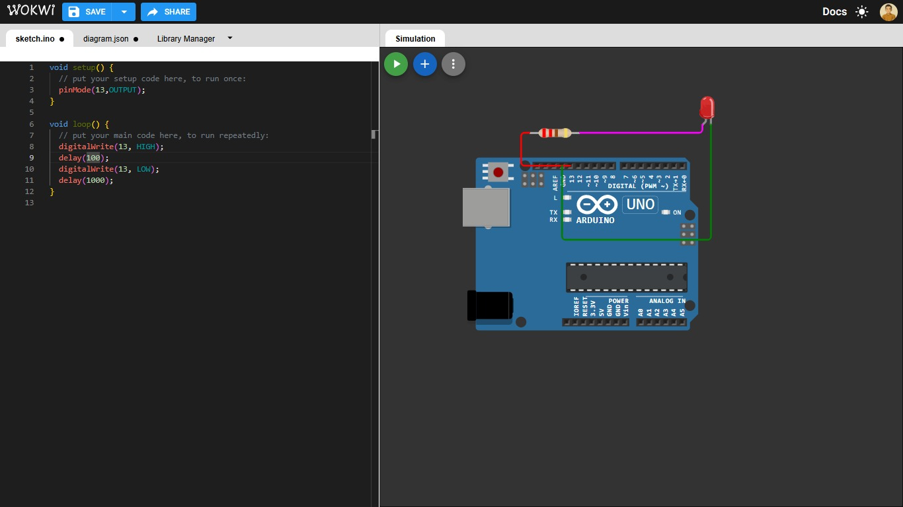

# 01 - Blinking LED

Turning an LED on and off, alternating every 1 second.

## Components
- Arduino Uno
- LED
- 220Ω Resistor

## Circuit
Pin 13 → Resistor → LED Anode → LED Cathode → GND

## Concepts Learned
`setup()`, `loop()`, `pinMode`, `digitalWrite`, `delay`

## Issues & Solutions
- (LED does not turn on because the anode and cathode are swapped)

## Simulation
[Open in Wokwi](https://wokwi.com/projects/479864420551956481)
