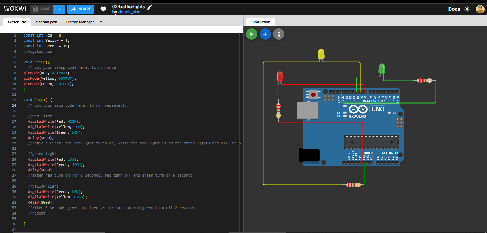

# 02 - Traffic Lights

A traffic light simulation that cycles through red, green, and yellow, then repeats.

## Components
- Arduino Uno
- 3 LEDs (red, yellow, green)
- 3 × 220Ω resistors

## Circuit
Pin 8 → Resistor → Anode → Cathode → GND 
Pin 9 → Resistor → Anode → Cathode → GND 
Pin 10 → Resistor → Anode → Cathode → GND 

## Concepts Learned
- `const int` to give names to pin numbers
- Controlling multiple outputs at once
- Code in `loop()` runs from top to bottom
- Turning off the previous LED so two don't light up at the same time

## Problems & Solutions
- Two LEDs on at the same time: make sure there is a `digitalWrite(..., LOW)` for the previous LED.
- `not declared` error: check the capitalization of the variable names.

## Simulation
[Open in Wokwi](paste-wokwi-share-link)
